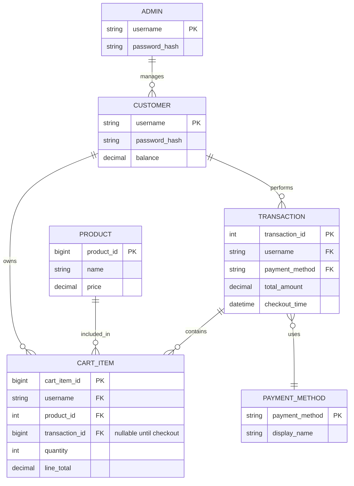

# Convenience Store ERD

This document explains the logical entity relationship design behind the Java convenience store console app.

## Detailed explanation

### 1. Customer
The `Customer` entity represents a shopper. It has the following attributes:
- `username`: unique login name
- `password_hash`: salted PBKDF2 hash of the login credential
- `balance`: available wallet value for purchases

Customer accounts are stored in PostgreSQL and loaded by the `Login` class when a shopper signs in.

### 2. Product
The `Product` entity represents an item sold in the store. Each product has:
- `name`
- `price`

The sample catalog is inserted into PostgreSQL the first time the product table is empty. Products are then read from the `products` table.

### 3. Cart item
Open carts and completed purchase lines are stored in the `cart_items` table. A cart line has a null `transaction_id` while it is still in an open cart.

This logically creates a bridge entity, `CartItem`, with the following aspects:
- customer reference
- product reference
- quantity
- line total

This is important because one customer can buy multiple products, and one product can appear in many customer carts.

### 4. Transaction
A transaction happens when the customer checks out. The app calculates the total cart value and subtracts it from the customer's balance. This is the business event that converts a cart into a completed purchase.

Conceptually, a transaction includes:
- `username` of the buyer
- selected payment method
- total amount charged
- checkout timestamp

The app prints a demo receipt and attaches the cart lines to the new transaction. Those lines remain in the database as purchase history and no longer appear in the open cart.

### 5. Payment method
The payment type is modeled by the `PaymentMethod` enum:
- `CASH_ON_DELIVERY`
- `GCASH`
- `CARD`

This entity links the transaction to the method selected by the customer during checkout.

### 6. Admin
The admin is a separate role stored in the `admins` table. Set `ADMIN_USERNAME` and `ADMIN_PASSWORD` to create the initial admin record; the password is stored as a salted PBKDF2 hash.

The admin is able to view registered customer usernames and balances but is not allowed to see customer passwords. This role is separate from the shopping workflow and represents system management.

## Core relationships
- One customer can own many cart items.
- One product can appear in many cart items.
- One customer can perform many transactions.
- One transaction can contain many cart items.
- One transaction uses one payment method.
- One admin can manage many customer records.

## Business rules implied by the system
1. A username must be unique.
2. Quantity must be greater than zero.
3. The customer balance must be sufficient before checkout.
4. A cart cannot be empty during checkout.
5. Open cart items are cleared after checkout by assigning them to the completed transaction; those rows remain as purchase history.
6. Admin credentials are stored separately from customer login data.

## Practical interpretation
The application implements the ERD with PostgreSQL tables:
- `customers`
- `products`
- `cart_items`
- `transactions`
- `payment_methods`
- `admins`

`minimarketkompleks/src/main/resources/schema.sql` creates these tables and their foreign-key constraints.
