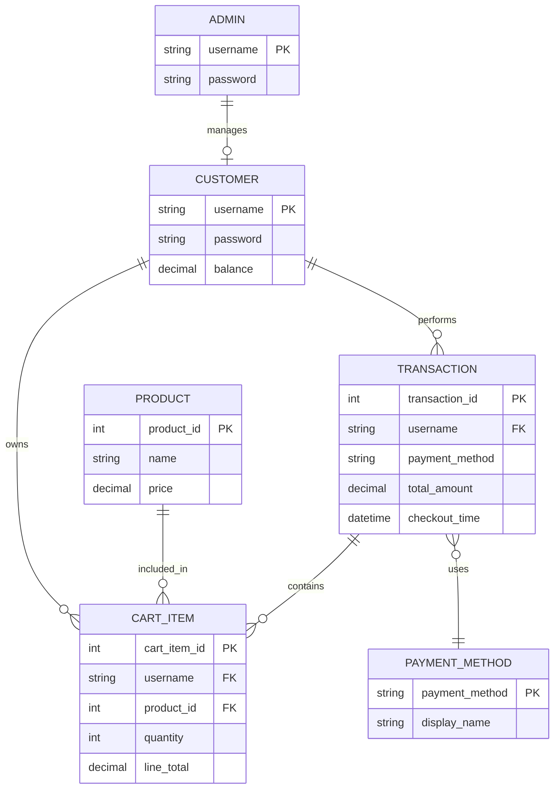

# Convenience Store ERD

This document explains the logical entity relationship design behind the Java convenience store console app.

## Detailed explanation

### 1. Customer
The `Customer` entity represents a shopper. It has the following attributes:
- `username`: unique login name
- `password`: login credential
- `balance`: available wallet value for purchases

In the app, customers are created and managed by the `Login` class, which stores them in a map keyed by username. This makes each customer account unique and allows the app to look up the current person who is logged in.

### 2. Product
The `Product` entity represents an item sold in the store. Each product has:
- `name`
- `price`

The store catalog is built in `Main.java` and stored in a list inside the `Store` class. The product list is effectively the inventory or catalog of goods available for purchase.

### 3. Cart item
The project does not have a separate database table for a cart, but the in-memory structure behaves like one. The `Store` class stores a map of `Customer` to a map of `Product` to `quantity`.

This logically creates a bridge entity, `CartItem`, with the following aspects:
- customer reference
- product reference
- quantity
- line total

This is important because one customer can buy multiple products, and one product can appear in many customer carts.

### 4. Transaction
A transaction happens when the customer checks out. The app calculates the total cart value and subtracts it from the customer's balance. This is the business event that converts a cart into a completed purchase.

Conceptually, a transaction includes:
- `username` of the buyer
- selected payment method
- total amount charged
- checkout timestamp

The app prints a demo receipt and then clears the cart.

### 5. Payment method
The payment type is modeled by the `PaymentMethod` enum:
- `CASH_ON_DELIVERY`
- `GCASH`
- `CARD`

This entity links the transaction to the method selected by the customer during checkout.

### 6. Admin
The admin is a separate role with hard-coded credentials:
- `admin`
- `admin123`

The admin is able to view registered customer usernames and balances but is not allowed to see customer passwords. This role is separate from the shopping workflow and represents system management.

## Core relationships
- One customer can own many cart items.
- One product can appear in many cart items.
- One customer can perform many transactions.
- One transaction can contain many cart items.
- One transaction uses one payment method.
- One admin can manage many customer records.

## Business rules implied by the system
1. A username must be unique.
2. Quantity must be greater than zero.
3. The customer balance must be sufficient before checkout.
4. A cart cannot be empty during checkout.
5. The cart is cleared after successful checkout.
6. Admin credentials are separate from customer login data.

## Practical interpretation
Although the app uses in-memory Java collections rather than a database, the design still follows a classic relational model. In a future version, the same structure could be implemented as SQL tables such as:
- `customers`
- `products`
- `cart_items`
- `transactions`
- `payment_methods`
- `admins`

This ERD is a useful blueprint for upgrading the app into a real database-backed system.
