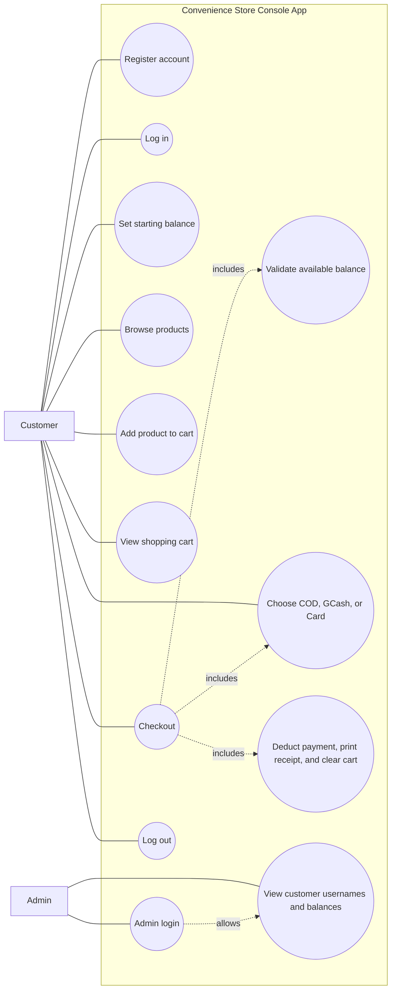
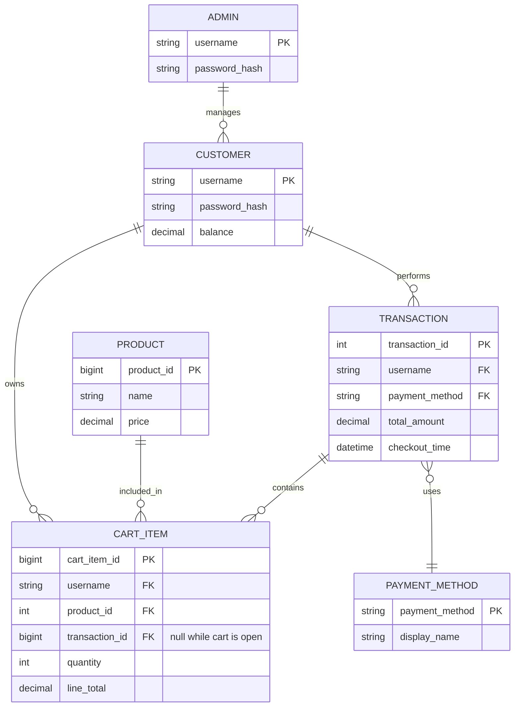

# Convenience Store App

A Java console application with an optional browser UI backed by a Java HTTP API.
Customers
can create an account, log in, browse a sample product list, make purchases with
their account balance, and view their shopping cart. Items are charged to the
customer's demo balance only when they choose **Checkout**. Checkout lets the
customer select Cash on Delivery, GCash, or Card as a demo payment method. These
choices do not contact a payment provider or process real payments; the demo
balance is still deducted for each successful checkout.
After adding an item, customers can add another product or return to the main
menu.
An admin can log in to add products to the customer catalog and view registered
customer usernames and balances, but cannot view customer passwords. Product
names must be unique; prices are entered in PHP and may have up to two decimal
places. The admin also sets the initial stock quantity. Customer carts and
checkout respect available stock, and successful orders reduce inventory.
Existing products receive an initial stock of 100 units when the database
schema is upgraded to include inventory tracking. Admins can register
additional administrators from the separate admin access page after confirming
their own password.

The sample product names are shown in English. Prices are displayed in
Philippine pesos (PHP) and are illustrative estimates for common Philippine
grocery pack sizes. Actual prices vary by brand, retailer, and location.

---


## Use case diagram



Customer accounts, balances, products, open carts, and completed transactions
are persisted in PostgreSQL. Admin accounts are stored separately, and customer
and admin passwords are stored as salted PBKDF2 hashes.

## Entity Relationship Diagram (ERD)

The application uses PostgreSQL tables for customer accounts, the product
catalog, shopping carts, checkout transactions, payment methods, and admins.



### Detailed explanation

#### 1. Customer entity
The `Customer` entity represents a registered shopper in the convenience store.
In the code, each customer is created with:
- `username`
- `password`
- `balance`

The `Login` class stores all customer accounts in a map keyed by username, so
there is effectively a one-to-many relationship between the system and its
customer records. A customer can log in, set an initial balance, add products
to the cart, and complete checkout.

Business rules:
- A username must be unique in the system.
- A customer may not check out if the cart total exceeds the available balance.
- A customer balance is reduced only after a successful checkout.

#### 2. Product entity
The `Product` entity describes each item sold by the store. Each product has:
- `name`
- `price`

In the app, products are created in `Main.java` and stored in a list inside the
`Store` object. This represents the catalog. A product can be selected by the
customer, added to the cart, and purchased during checkout.

Business rules:
- Product price is fixed at the time the item is added to the catalog.
- A product can appear multiple times in many carts, as long as each cart entry
  keeps its own quantity.
- The cart only validates the selected product number and quantity before
  accepting the item.

#### 3. Cart item entity
The `Store` class uses a `Map<Customer, Map<Product, Integer>>` structure. This
means each customer has a shopping cart, and each cart contains product-quantity
pairs. This is conceptually a many-to-many relationship between `Customer` and
`Product`, resolved through a bridge entity called `CartItem`.

A cart item usually contains:
- customer reference
- product reference
- quantity
- line total

This is the most important relationship in the ERD because it captures the
actual purchase intent. It also preserves repeated items in the cart—for example,
three packs of noodles or two bottles of cooking oil.

Business rules:
- Quantity must be greater than zero.
- The cart total cannot exceed the customer balance when a product is added.
- A customer can have multiple products in their cart at the same time.

#### 4. Transaction entity
When the customer chooses checkout, the application computes the total cost of
all cart items and then deducts the total from the customer balance. This is the
logical equivalent of a transaction.

The transaction concept includes:
- customer who performed the purchase
- selected payment method
- total amount
- time of checkout

The `transactions` table records completed purchases. Checked-out cart lines
retain their `transaction_id` as purchase history.

Business rules:
- Checkout is only allowed when the cart is not empty.
- Transaction total must be less than or equal to the customer balance.
- The cart is cleared immediately after a successful checkout.

#### 5. Payment method entity
The app uses an enum named `PaymentMethod` with the values:
- `CASH_ON_DELIVERY`
- `GCASH`
- `CARD`

This is represented in the ERD as a lookup table or enumerated entity. It lets
an order or transaction indicate how the customer intends to complete payment,
without performing a real payment gateway operation.

Business rules:
- Only valid payment methods are accepted.
- The selected method is printed on the receipt as part of the demo checkout.

#### 6. Admin entity
The admin is not a normal customer account. Admin credentials are configured
with `ADMIN_USERNAME` and `ADMIN_PASSWORD` and saved in the separate `admins`
table as a salted password hash.

The admin is allowed to view registered customer usernames and balances, but the
application deliberately does not reveal customer passwords. This gives the ERD a
separate administrative role without mixing admin logic with customer data.

Business rules:
- Admin must log in separately from customer users.
- Admin cannot register or buy products through the customer workflow.
- Admin sees account summaries only, not personal password information.

### Relationship summary

The core relationships are:
- One `Customer` has many `CartItem` rows.
- One `Product` can belong to many `CartItem` rows.
- One `Customer` performs many `Transaction` records.
- One `Transaction` contains many `CartItem` entries.
- One `Transaction` uses exactly one payment method.

This structure matches the real purchase flow in the application:
1. Customer registers and logs in.
2. Customer selects products.
3. Selected items are stored as cart entries.
4. Customer checks out.
5. Total is deducted from balance and the cart is cleared.

### Why this ERD matters

The ERD maps to the PostgreSQL schema at
`minimarketkompleks/src/main/resources/schema.sql`. It describes how the app
models customer accounts, product inventory, cart entries, and purchases.

## Run from the console

Install a Java Development Kit (JDK), Maven, and PostgreSQL. Create a PostgreSQL
database (for example, `minimarket`), then edit the root `.env` file with your
PostgreSQL and admin credentials:

The `.env` file is excluded from Git so your password stays local.
`DATABASE_URL`, `DATABASE_USERNAME`, and `DATABASE_PASSWORD` are required.
`ADMIN_USERNAME` and `ADMIN_PASSWORD` must be set together; on first startup,
they create an admin account if that username does not already exist. The app
creates the ERD tables and payment-method rows automatically, and loads the
sample catalog when the products table is empty. On Windows, run `run.bat` from
the project folder. Alternatively, run:

```powershell
mvn -f minimarketkompleks/pom.xml exec:java
```

## Run with the browser UI

Use the same PostgreSQL configuration above. On Windows, run `run-web.bat` from
the repository folder, then open <http://127.0.0.1:8765>. The Java server serves
the UI and its API from the same origin. The API supports registration, sign-in,
demo balance setup, browsing products, persistent cart updates, checkout, and
admin customer account viewing. Customers can browse and build a guest cart
before signing in; that cart is saved in the browser and merged into the account
cart after sign-in. Registration signs the new customer in automatically.
Payment is selected from the cart and still requires a final order confirmation.
Set `PORT` in the environment to use a different local port. Payment method
selection is recorded for the demo checkout; no real payment provider is
contacted.

## Import and run in Eclipse

1. Install a JDK (Java 8 or newer) and Eclipse IDE for Java Developers.
2. In Eclipse, choose **File → Import → Maven → Existing Maven Projects**.
3. Set the root directory to the `minimarketkompleks` folder and finish the
   import. Eclipse may take a moment to download Maven dependencies.
4. Select the imported project and choose **Project → Clean** if Eclipse shows
   stale build errors.
5. Open `src/main/java/com/conveniencestore/Main.java`, then choose **Run As →
   Java Application**. Alternatively, use the included
   `Convenience Store Console App.launch` run configuration.

The Maven project targets Java 8 bytecode and uses the JUnit dependency for
tests. If Eclipse reports an execution environment error, configure the
workspace JRE under **Window → Preferences → Java → Installed JREs** and select
a JDK 8 or newer.
