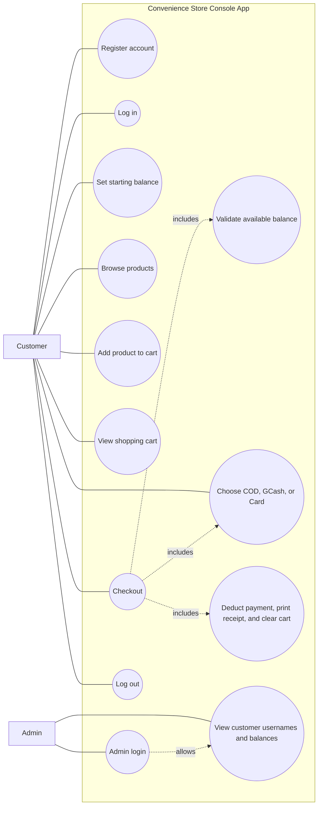

# Convenience Store Console App

A Java console application that simulates a simple shopping experience. Customers
can create an account, log in, browse a sample product list, make purchases with
their account balance, and view their shopping cart. Items are charged to the
customer's demo balance only when they choose **Checkout**. Checkout lets the
customer select Cash on Delivery, GCash, or Card as a demo payment method. These
choices do not contact a payment provider or process real payments; the demo
balance is still deducted for each successful checkout.
After adding an item, customers can add another product or return to the main
menu.
An admin can log in to view registered customer usernames and balances, but
cannot view customer passwords.

The sample product names are shown in English. Prices are displayed in
Philippine pesos (PHP) and are illustrative estimates for common Philippine
grocery pack sizes. Actual prices vary by brand, retailer, and location.

---

## Use case diagram

For this in-memory demo, the admin login is `admin` / `admin123`. These are
demo-only credentials and must not be used in a real deployment. User accounts
and balances are not persisted when the application exits.

## Run from the console

Install a Java Development Kit (JDK) and make sure both `java` and `javac` are
available on your `PATH`. On Windows, run `run.bat` from the project folder or
double-click it. The script compiles the application and starts the interactive
console program.

## Import and run in Eclipse

1. Install a JDK (Java 8 or newer) and Eclipse IDE for Java Developers.
2. In Eclipse, choose **File → Import → Maven → Existing Maven Projects**.
3. Set the root directory to the `minimarketkompleks` folder and finish the
   import. Eclipse may take a moment to download Maven dependencies.
4. Select the imported project and choose **Project → Clean** if Eclipse shows
   stale build errors.
5. Open `src/main/java/com/conveniencestore/Main.java`, then choose **Run As →
   Java Application**. Alternatively, use the included
   `Convenience Store Console App.launch` run configuration.

The Maven project targets Java 8 bytecode and uses the JUnit dependency for
tests. If Eclipse reports an execution environment error, configure the
workspace JRE under **Window → Preferences → Java → Installed JREs** and select
a JDK 8 or newer.
